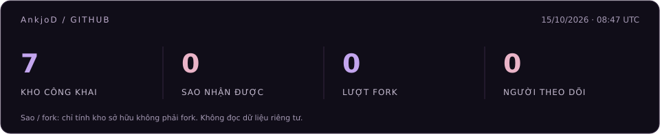

  

  <a href="https://github.com/AnkjoD?tab=repositories">Dự án</a>
  &nbsp;&nbsp;·&nbsp;&nbsp;
  <a href="https://github.com/AnkjoD?tab=stars">Đã đánh dấu sao</a>

<h3 align="center">Công nghệ sử dụng</h3>

  

  Java &nbsp; / &nbsp; Python &nbsp; / &nbsp; ReactJS &nbsp; / &nbsp; Node.js &nbsp; / &nbsp; TypeScript

<h3 align="center">Kho mã nguồn</h3>

<!-- Các kho công khai đã được xác nhận; đổi liên kết khi muốn giới thiệu kho khác. -->

  <a href="https://github.com/AnkjoD/HomuraSmartFace"><strong>HomuraSmartFace</strong></a>
  &nbsp;&nbsp;·&nbsp;&nbsp;
  <a href="https://github.com/AnkjoD/NhaTroHomu"><strong>NhaTroHomu</strong></a>
  &nbsp;&nbsp;·&nbsp;&nbsp;
  <a href="https://github.com/AnkjoD/MusicStream"><strong>MusicStream</strong></a>

 

  
Thống kê GitHub

   
  

    
  

  

    Cập nhật hằng ngày · Sao và fork chỉ tính trên các kho sở hữu không phải fork.
  

<!-- Chỉnh nội dung tại đây; hướng dẫn cài đặt và cập nhật nằm trong SETUP.md. -->

