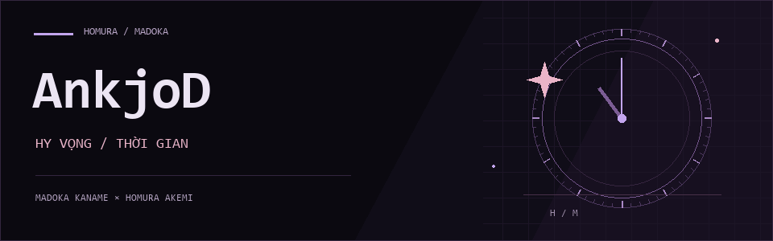

  

  <a href="https://github.com/AnkjoD?tab=repositories">Dự án</a>
  &nbsp;&nbsp;·&nbsp;&nbsp;
  <a href="https://github.com/AnkjoD?tab=stars">Đã đánh dấu sao</a>

<h3 align="center">Công nghệ sử dụng</h3>

  

  Java &nbsp; / &nbsp; Python &nbsp; / &nbsp; ReactJS &nbsp; / &nbsp; Node.js &nbsp; / &nbsp; TypeScript

 

  

<!-- Chỉnh nội dung tại đây; hướng dẫn cài đặt và cập nhật nằm trong SETUP.md. -->

